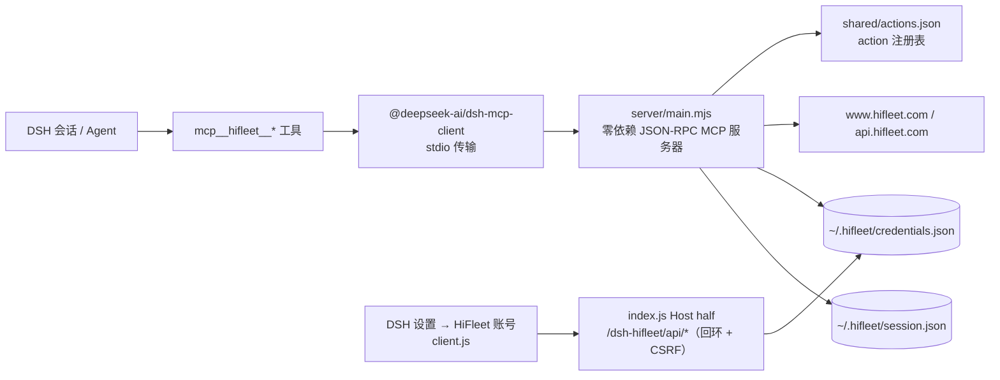

<p align="center">
  
</p>

<h1 align="center">HiFleet 工具</h1>

<p align="center">
  <strong>把 HiFleet 的船舶数据接进 DeepSeek Harness：11 个模块化 MCP 工具，一处图形账号设置。</strong>
</p>

<p align="center">
  <a href="https://github.com/LiuHongXuMaritime/dsh-hifleet-mcp"></a>
  
  
  
  
</p>

> 非官方插件，与 HiFleet 官方无隶属关系。请遵守目标站点的服务条款与访问限制；账号需自行在 HiFleet 官网注册。

---

## 它是什么

本仓库是 **HiFleet Tools**（上游作者 **Creeper2026**，版本 **2.1.1**，Trae 插件格式）的 **DeepSeek Harness（DSH）发行形态**。

- 内置上游的**零依赖 Node MCP 服务器**，通过 DSH 的 `@deepseek-ai/dsh-mcp-client` 以 **stdio** 接入；
- 把上游按模块聚合的 **11 个工具**原样发布为 `mcp__hifleet__<原工具名>`；
- 额外提供一个**图形账号设置页**（DSH 设置 → “HiFleet 账号”），保存账号后下一次工具调用自动登录；
- 附带上游的渐进式技能文档 `skills/hifleet/`（`SKILL.md` + `reference/*.md`），Agent 按需加载。

调用格式与上游一致：`{ "action": "…", "params": { … } }`；写操作需在同级传 `"confirm": true`。

---

## 为什么用它

- **一次装好，11 个模块直接用。** 船舶、轨迹、航线、港口、班期、船队、台风、账号，各自一个工具，按模块聚合，不刷屏。
- **账号在 GUI 里填。** 不用命令行、不用改配置文件、不用把手机号密码发进对话；支持手机号/邮箱登录。
- **保存即生效。** 本发行版在 `ensureAuth()` 里加了“每次鉴权前重读会话/凭据”的补丁，登录或换号后**无需重启 DSH**。
- **可移植。** `cordis.patch.yml` 不含任何绝对路径；移动目录、换电脑、别人从 GitHub 安装都不需要改配置。
- **不需要另装 Node.js。** 默认复用 DSH 自带的 Electron 运行时（Electron 44 / 内置 Node 24）启动 MCP 服务器。
- **凭据不出本机。** 账号密码只落在用户 profile 下的本地文件，仓库/分发包里不含任何凭据；写接口仅限回环并带 CSRF 防护。
- **上游更新可跟。** 运行时是上游的副本，附同步命令，功能文档与上游保持一致。

---

## 快速开始

### 1. 安装到 DSH

本 bundle 是 **profile 级插件**，安装后**新建会话**即可看到 `mcp__hifleet__*` 工具。

- 方式一（图形界面）：DSH → 插件管理 → 安装本地 bundle → 选择本目录。
- 方式二（等价接口）：`plugin_manager` 的 `install_bundle`，target 填本目录的绝对路径
  （不同机器填该机器上的路径即可，本 bundle 内部不依赖任何绝对路径）。

### 2. 自检

1. 配置里出现 `include:hifleet-mcp`（`@deepseek-ai/dsh-mcp-client` 的 config 条目）；
2. 工具列表出现 11 个 `mcp__hifleet__*` 工具；
3. 调用 `hifleet_help` 返回模块列表，或调用 `hifleet_session` 看到 `loggedIn` 状态即接入成功。

> 同一 profile 内 `serverName` 必须唯一（本插件用 `hifleet`）。本 bundle 包名为
> `@local/dsh-hifleet-tools`（更早的本地安装曾用 `@local/dsh-hifleet-mcp`，两者不同名）；
> 安装/卸载请认准当前包名。

### 3. 设置账号（推荐）

1. 打开 **DSH 设置 → “HiFleet 账号”**；
2. 填写 HiFleet 用户名（手机号/邮箱）和密码，点“保存”；
3. 下一次调用 HiFleet 工具时会自动用这组账号登录，**无需重启 DSH**。

插件详情页（插件管理 → HiFleet Tools）里有同一个面板——同一份状态与按钮。

- 凭据保存在 `%USERPROFILE%\.hifleet\credentials.json`（可用 `HIFLEET_CREDENTIALS` 覆盖）；
  仅在本机落盘，保存后密码不再回显，面板只显示“已保存”状态。
- 保存后会**一律清除旧的登录会话**（换账号、同一账号改密码都适用），下一次调用用新凭据重新登录。
- “删除”按钮只删本地凭据文件；已登录的会话要另用 `hifleet_account` 的 `logout`，或删除 `session.json`。

### 4. 试一试

```
hifleet_help                         # 看模块与 action
hifleet_session                      # 看登录状态
hifleet_vessel  action=search params={"keyword":"MAERSK"}
hifleet_route   action=point_to_point params={"start":"121.666667,38.916667","end":"9.933333,53.533333"}
```

---

## 工具一览

| 工具 | 覆盖范围 | 文档 |
|---|---|---|
| `hifleet_vessel` | 列表、搜索、档案、航次、挂靠、PSC、事故、风险、图片 | `skills/hifleet/reference/02-vessels.md`、`03-detail.md` |
| `hifleet_track` | 轨迹、停船点、全量船位、风场、吃水、SDK 位置 | `04-track.md` |
| `hifleet_route` | 气象航线、点到点、航线计划、沿航线天气、潮汐 | `05-route-weather.md` |
| `hifleet_port` | 港口经纬度、在港/预抵、天气、详情、OneOcean、留言 | `06-port.md` |
| `hifleet_schedule` | 班期列表/详情/关注/统计/联想/解锁 | `07-schedules.md` |
| `hifleet_fleet` | 船队船舶、分组、增删、权限、船舶报告 | `08-fleet-user.md` |
| `hifleet_typhoon` | 台风、地震、海况矢量、海浪/海图瓦片 | `09-typhoon.md` |
| `hifleet_account` | 会话、登录、登出、权限 | `08-fleet-user.md` |
| `hifleet_help` | 返回模块/action/文档路径 | — |
| `hifleet_session` | 本地会话状态 | — |
| `hifleet_request` | 兜底通用请求 | `01-common.md` |

完整 action 与参数见工具内 `hifleet_help` 返回的路径（即 `skills/hifleet/reference/*.md`）。

---

## 账号与登录

### 方式 A：设置页（推荐）

见上文「快速开始 → 设置账号」。适合日常使用与更换账号。

### 方式 B：双击 `login.cmd`（无图形界面时）

1. 在插件目录双击 `login.cmd`（也可以把快捷方式发给使用者）；
2. 按提示输入 HiFleet 账号，密码输入时不回显；
3. 看到“登录成功，会话已保存”即可回到 DSH 直接使用。

> **登录即时生效**：DSH 运行期间完成登录后，下一次工具调用自动使用新会话，无需重启 DSH。

### 方式 C：部署/无人值守（`.env` 自动登录）

把 `.env.example` 复制为 `.env` 并填写账号密码：

```powershell
copy .env.example .env
notepad .env
```

首次调用需要登录的工具时会自动登录并保存会话，之后不再重复登录。适合“一个账号供整个 DSH 使用”的部署；`.env` 已被 `.gitignore` 忽略，不要外传。

### 方式 D：命令行登录

```powershell
node server\login.mjs
```

### 不推荐的方式

- 对话中让 Agent 调用 `hifleet_account` 的 `login` action 传账号密码：能用，但密码会进入会话历史，只适合临时排障；用完建议调用 `logout` 并轮换密码。
- 不要把密码写进 `cordis.patch.yml` 或 MCP `config.env`：那是随 bundle 分发的配置；请用本目录 `.env`（本地、被忽略）或双击 `login.cmd`。

### 凭据来源优先级

```
进程/MCP 配置 env（含 .env 载入值）  >  设置页保存的 credentials.json
```

其余配置优先级：MCP 配置 env > `.env` > 代码默认值。

---

## 环境变量

| 变量 | 说明 |
|---|---|
| `HIFLEET_USERNAME` / `HIFLEET_PASSWORD` | 自动登录账号（推荐写在 `.env`） |
| `HIFLEET_AUTO_LOGIN` | 设为 `0` 关闭自动登录 |
| `HIFLEET_SESSION` | 自定义会话文件路径（默认 `%USERPROFILE%\.hifleet\session.json`） |
| `HIFLEET_ENV_FILE` | 自定义 `.env` 路径 |
| `HIFLEET_CREDENTIALS` | 自定义账号密码文件路径（默认 `%USERPROFILE%\.hifleet\credentials.json`） |

> DSH 启动 stdio MCP 时会清洗继承环境变量：名称匹配 `KEY|PASSWORD|SECRET|TOKEN` 的变量
> 和 `DSH_*` 会被移除。因此不要把账号密码依赖 `process.env` 继承传入；请写进本目录的
> `.env`（服务器自己读取），或使用 DSH MCP 配置的 `config.env`（会覆盖清洗后的环境）。

---

## 架构



- **MCP 连接行**：`@deepseek-ai/dsh-mcp-client`（`serverName: hifleet`，stdio），由 `cordis.patch.yml` 声明；
- **Host half**（`index.js`）：只用 DSH `webServer` 注册两条 exact 路由，读写本地凭据文件；
- **Client half**（`client.js`）：纯 JS（无构建），注册 `settings.section` 与 `plugins.bundle.config`；
- **运行时**：Node 零依赖，stdout 只输出 JSON-RPC，日志走 stderr。

---

## 可移植性与运行时

`cordis.patch.yml` 里**没有任何绝对路径**，所以：

- 把本目录移动到任何位置（换电脑、改名文件夹、从 GitHub clone 到任意路径）都**不需要修改本文件**；
- `command` 复用 DSH 自带的 Electron（搭配 `ELECTRON_RUN_AS_NODE=1`）当 Node 用，
  因此**不要求使用者单独安装 Node.js**；如果 DSH 本身由 Node 启动，`process.execPath` 自动等于 node；
- `args` / `cwd` 由 Loader 的 `!!js` 表达式在加载时算出：
  `baseUrl`（当前 profile 目录）+ 包名（`package.json` 的 `name`）→
  `<profile>/node_modules/@local/dsh-hifleet-tools/server/main.mjs`。

只有在 **改了 `package.json` 的 `name`**（例如 fork 后重命名包）时，才需要把
`cordis.patch.yml` 中两处 `node_modules/@local/dsh-hifleet-tools` 换成新包名。
如果更想用系统 Node（>= 20.19.0）：把 `command` 改成 `node`，并删掉 `env` 里的
`ELECTRON_RUN_AS_NODE` 即可。

---

## 安全与隐私

- 凭据只写本机：`%USERPROFILE%\.hifleet\credentials.json`，接口仅接受**回环**请求；
- 写接口要求 `content-type: application/json` + 自定义头 `x-dsh-hifleet: 1`（CSRF 防护），跨站页面无法伪造；
- 面板保存后密码不再回显；仓库与分发包中**不含任何账号、Cookie、会话或日志**；
- 已知局限：凭据文件是明文 JSON（权限依赖用户目录 ACL），请勿在共享账户/共享机器上保存密码；
- 这是非官方集成，工具会把目标站点的错误（如 `CAPTCHA_REQUIRED`、配额限制、`LOGIN_REQUIRED`）原样返回给 Agent。

---

## 目录结构

```text
dsh-hifleet-mcp/
├── package.json            # DSH bundle 清单（dsh.bundle.patch 指向 cordis.patch.yml）
├── cordis.patch.yml        # MCP 连接声明 + Host half 行（无绝对路径）
├── index.js                # Host half：/dsh-hifleet/api/* 路由（凭据状态/保存/删除）
├── client.js               # 浏览器设置页：DSH 设置 → “HiFleet 账号”（纯 JS，无需构建）
├── login.cmd               # Windows 双击登录入口（密码输入不回显）
├── locale/{en,zh}.json     # 插件显示名/描述
├── icon.svg                # 插件图标（沿用上游 assets/app-icon.svg）
├── server/                 # 内置零依赖 Node MCP 服务器
│   ├── main.mjs            # stdio JSON-RPC 服务
│   ├── client.mjs          # HTTP / Cookie / mtk / 本地会话
│   ├── env.mjs             # .env 读取
│   ├── tools.mjs           # 模块工具 + action 分发（含 DSH 适配补丁）
│   └── login.mjs           # 本地登录 CLI（不是 MCP tool）
├── shared/actions.json     # 全量 action 注册表
├── skills/hifleet/         # 渐进式文档（SKILL.md + reference/*.md）
├── .env.example            # 自动登录模板（复制为 .env 后填写）
├── .gitignore              # 忽略 .env / 会话文件 / IDE 文件
├── PROVENANCE.md           # 上游来源、转换记录与 SHA-256
└── README.md               # 本文件
```

---

## 与上游 Trae 插件（hifleet-mcp）的差异

保留：`server/*.mjs`（Node 实现）、`shared/actions.json`、`skills/hifleet/**`、`.env.example`、`.gitignore`。

DSH 形态新增：`package.json`、`cordis.patch.yml`、`locale/{en,zh}.json`、`icon.svg`、
`README.md`（本文件）、`PROVENANCE.md`、`login.cmd`、`index.js`（Host half，设置接口路由）、
`client.js`（浏览器设置页）。图标沿用上游 `assets/app-icon.svg`。

DSH 适配补丁（详见 `PROVENANCE.md`）：

- `ensureAuth()` 每次鉴权前重读会话/凭据文件，登录与换号即时生效；
- 凭据变化时重置进程内旧 Cookie，并释放登录缓存，避免“已登录态”吞掉新凭据；
- 保存账号后清除旧会话，覆盖“同账号改密码”；
- 写接口增加回环 + CSRF 头校验。

未包含（Trae 专属或 DSH 用不到）：

- `.trae-plugin/plugin.json`、`.mcp.json`、`.mcp.python.json`、`mcp.local*.json` —— Trae 的清单与本地配置；
- `server_py/`（Python 实现）—— DSH bundle 只保留 Node 运行时；如需 Python 版请用上游插件；
- `__pycache__/`、`.idea/` 等构建/IDE 产物。

---

## 升级 / 同步上游

本目录的运行时是 `..\hifleet-mcp` 的副本。上游更新后，从 `..\hifleet-mcp` 覆盖：

```powershell
Copy-Item ..\hifleet-mcp\server\*.mjs .\server\ -Force
Copy-Item ..\hifleet-mcp\shared\actions.json .\shared\ -Force
Copy-Item ..\hifleet-mcp\skills\hifleet\* .\skills\hifleet\ -Recurse -Force
```

然后同步修改 `package.json` 的 `version`，确认 `cordis.patch.yml` 路径未变，再重装 bundle。
（DSH 适配补丁需要在覆盖后重新应用；`PROVENANCE.md` 记录了改动点与参考 SHA-256。）

---

## 自测

```powershell
node --check server\main.mjs
node --check server\client.mjs
node --check server\env.mjs
node --check server\tools.mjs
node --check server\login.mjs
```

手工 stdio 握手（PowerShell）：

```powershell
$lines = @(
  '{"jsonrpc":"2.0","id":1,"method":"initialize","params":{"protocolVersion":"2025-06-18","capabilities":{},"clientInfo":{"name":"probe","version":"1"}}}',
  '{"jsonrpc":"2.0","id":2,"method":"tools/list"}'
) -join "`n"
$lines | node server\main.mjs
```

stdout 只输出 JSON-RPC 消息，日志全部在 stderr（`[hifleet-mcp] server started (stdio)`）。

设置页接口自测（DSH 需正在运行，`$port` 换成实际 GUI 端口）：

```powershell
$port = 64771
Invoke-WebRequest "http://127.0.0.1:$port/dsh-hifleet/api/status" -UseBasicParsing
# 保存（仅本机回环，示例值请替换；测试完请调用 DELETE 清除）
Invoke-WebRequest "http://127.0.0.1:$port/dsh-hifleet/api/credentials" -Method Post `
  -ContentType 'application/json' -Body '{"username":"you","password":"secret"}' `
  -Headers @{ 'x-dsh-hifleet' = '1' } -UseBasicParsing
Invoke-WebRequest "http://127.0.0.1:$port/dsh-hifleet/api/credentials" -Method Delete `
  -Headers @{ 'x-dsh-hifleet' = '1' } -UseBasicParsing
```

---

## 故障排查

| 现象 | 处理 |
|---|---|
| 工具没出现 | 新建会话；确认配置有 `include:hifleet-mcp`、包已安装且 enabled |
| `LOGIN_REQUIRED` / 登录失败 | 打开设置页保存账号密码；或用 `login.cmd`、`.env`；注意验证码/风控时改用 Cookie 登录 |
| `CAPTCHA_REQUIRED` / `s402` / 配额限制 | 站点匿名访问限额，等 24h 或登录后重试；可用 `hifleet_session` 查看会话状态 |
| 工具调用报服务器启动失败 | 检查 `cordis.patch.yml` 的 `args` 是否指向存在的 `server/main.mjs`；改过包名时同步改路径表达式 |
| 设置页打不开/面板空白 | 确认 bundle 已启用、浏览器 bundle 加载正常；重载插件或刷新页面 |
| 换账号后仍是旧账号 | 保存时会清旧会话；若仍异常，调用 `hifleet_account logout` 或删除 `session.json` 后重试 |

---

## 边界与许可

- 单 profile 单账号：同一 DSH profile 共用一个 HiFleet 会话；多账号请用不同 profile；
- 非官方：接口与字段以上游为准，站点改版可能导致部分 action 失效；本插件会把错误原样返回；
- 仅保留 Node 运行时；Python 版请使用上游插件；
- Windows 下提供 `login.cmd`，其他系统用 `node server/login.mjs` 或设置页。

上游 HiFleet Tools 未声明许可证（**UNLICENSED**），版权归上游作者 Creeper2026 所有；
本目录仅为其本地 DSH 集成副本。转换记录、文件对应关系与校验摘要见 [PROVENANCE.md](./PROVENANCE.md)。
